# RingSort

**A factory sorting cell that knows when it got a pick wrong.** A robot arm sorts mixed parts into one bin per part type, ready to be packed later. After every pick it checks what happened from the gripper's own position record, and a stand camera cross-checks the table. When a pick doesn't land, it stops and flags the operator instead of counting it.

Built at the AI Hackathon at #SFTechWeek (AMD track: Physical AI / Robotics, October 10–11, 2026), Mission 2: Freestyle build. SO-101 arms and Hugging Face LeRobot, on AMD from edge to cloud: an AMD Ryzen AI PC runs the cell; AMD Cloud with AMD Radeon AI PRO R9700 GPUs trains the models.

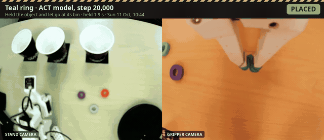

> **Demo video:** [one whole work order, start to finish](examples/full_run_20261011_1108.mp4) · **Recorded picks:** [below](#recorded-picks)
> **Datasets:** [purple](https://huggingface.co/datasets/varunsatish2017/kitcheck_pick_purple) · [teal](https://huggingface.co/datasets/varunsatish2017/kitcheck_pick_teal) · [red](https://huggingface.co/datasets/varunsatish2017/kitcheck_pick_red)
> **Models (used in the demo):** [teal step 20,000](https://huggingface.co/varunsatish2017/kitcheck_act_teal_020000) · [purple step 50,000](https://huggingface.co/varunsatish2017/kitcheck_act_purple_050000) · [red step 40,000](https://huggingface.co/varunsatish2017/kitcheck_act_red_040000) · earlier checkpoints: purple [10k](https://huggingface.co/varunsatish2017/kitcheck_act_purple_010000), [20k](https://huggingface.co/varunsatish2017/kitcheck_act_purple_020000), [40k](https://huggingface.co/varunsatish2017/kitcheck_act_purple_040000); red [10k](https://huggingface.co/varunsatish2017/kitcheck_act_red_010000), [20k](https://huggingface.co/varunsatish2017/kitcheck_act_red_020000)
> **Training logs:** [Weights & Biases](https://wandb.ai/devmello2/lerobot)

The code and the Hugging Face repos use the project's working name, **kitcheck**.

---

## Team

**RingSort**

## Mission

In a factory or assembly shop, parts arrive mixed: a supplier delivery, a disassembly line, a returns pile. Before anyone can pack kits or orders, each part type has to go into its own bin. Packing then pulls from those bins.

**Sorting is only useful if the bins can be trusted.** A part in the wrong bin, or one silently left behind, shows up downstream as a wrong kit or a short order, where it costs far more to find. Robots that learn by demonstration make this worse in one specific way: they fail silently. The model has no idea it missed.

RingSort is the sorting cell in that line. It fills one bin per part type and confirms every pick. When it can't confirm one, it stops and tells the operator, the way a line worker pulls the andon cord. Packing happens later, downstream, from bins it has filled.

**On the table**, colored rings stand in for part types (think O-rings or washers in different sizes), and a cup per color is that part's bin.

| In the factory | On the table |
|---|---|
| Part types | Rings: purple, teal, red |
| Mixed parts waiting to be sorted | Each ring in its pick area |
| One bin per part type | One cup per color |
| Line operator | The person at the station dashboard |
| Packing station downstream | Not built; it is the next stage in the story |

## Creativity

**A learned robot that checks its own work, with no extra sensor.** LeRobot already records, on every frame, where the gripper was told to go and where it actually got to. RingSort reads that record after every pick:

- **Holding a part:** the gripper can't close all the way, so the measured position stays above the commanded one. In our demonstrations the gap is about 13.5 on LeRobot's 0–100 gripper scale.
- **Picked up nothing:** the gripper closes fully, so there is no gap.
- **Slipped:** the gap disappears while the gripper is still told to stay closed.
- **Released in the right place:** the gripper is told to open while the base joint points where the demonstrations let go.

That turns each pick into **placed**, **missed** or **dropped**. Anything but placed stops the cell and goes to the operator, who chooses retry, placed by hand, skip or cancel. (An automatic retry after a miss can be switched on with `limits.auto_retries` in `config.json`; the demo uses one attempt per part.) Every attempt is logged, so the cell reports its own first-try success rate.

The check is separate evidence from the model: it doesn't use the model's outputs or its cameras, only what the gripper's motor measured.

**The cell also looks at its own table.** Whenever the arm is idle, the stand camera finds every part by color and checks:

- **Is each part where the cell was taught to pick it?** The taught area is learned from the first frame of every demonstration: where that part sat, mapped into one camera view. Day-1 runs showed this matters: every successful pick had the part near the middle of that area.
- **Did the pick really happen?** After every pick the gripper check calls placed, the camera looks again: the part should have left the table, and where the camera can see into the bin (purple), be in it. A part still on the table is flagged, never silently counted.
- **Has the camera moved?** It is matched against where each color's demonstrations were recorded, because a moved camera breaks a trained model.

Starting a work order warns the operator about a missing part or one outside its taught area. A "What's on the table" order sorts exactly the parts the camera sees. No model is involved in the camera checks: plain color thresholds, and the taught areas come from the demonstrations already recorded.

## How it works

```
operator taps a work order on the dashboard  (or: python -m kitcheck.runner "Sort all")
        |
        |  for each part in the order
        v
  run that part's ACT model on the arm      lerobot-rollout, 15 s limit, one recording per pick
        |
        v
  grasp check on the recording              kitcheck/grasp.py
        |
   +----+-----------------------+
   |                            |
 placed                  missed / dropped / error
   |                            |
 camera cross-check,     flag the operator:
 next part               retry / placed by hand / skip / cancel
        |
        v
  one line per attempt in data/runs.jsonl → first-try success rate
```

The skills are taught in a separate loop:

```
record demonstrations (leader arm drives follower)   PC
        → upload dataset                             Hugging Face
        → train ACT, checkpoint every 10k steps      AMD Cloud (Radeon AI PRO R9700)
        → download a checkpoint, a few scored picks  PC (scripts/try_model.sh)
        → weak? record more takes where it fails, continue training from the model
```

## Technical implementation

### Hardware

| Part | What |
|---|---|
| Arms | SO-101 leader and follower |
| Cameras | `front` on a stand looking down at the pick areas and bins; `wrist` on the gripper. 640×480 at 30 fps. |
| Run-time PC | AMD Ryzen AI MAX+ 395, Radeon 8060S (ROCm), Ubuntu 24.04, LeRobot 0.6.2 |
| Training | AMD Cloud, AMD Radeon AI PRO R9700 |

Everything at run time is local: the models run on the Ryzen AI PC's GPU and the cell makes no network calls.

### Data capture

- One skill per part type: pick the ring from its pick area, drop it in its bin, return to rest.
- Recorded by teleoperation: the leader arm drives the follower. Each take is started and stopped by hand, capped at 20 seconds, with a median length of 10 seconds.
- Every grasp uses a full squeeze of the leader's handle, so the grasp check has a clear signal. It was there in **63 of 63** purple takes, **45 of 45** teal takes and **47 of 47** red takes.
- Weak takes were removed with `lerobot-edit-dataset`, and uploads are checked against the take count and file list (`scripts/push_dataset.sh`).

| Part type | Takes | Dataset |
|---|---|---|
| Purple | 63 | `varunsatish2017/kitcheck_pick_purple` |
| Teal | 45 | `varunsatish2017/kitcheck_pick_teal` |
| Red | 47 (stand camera in an earlier position) | `varunsatish2017/kitcheck_pick_red` |

### Training

- **Model:** ACT, one model per part type. ACT can't be told which part to pick, and separate skills can be taught and fixed independently.
- **Recipe:** batch size 8 with a checkpoint every 10,000 steps. The organizers' example uses batch 64 for 20,000 steps. We traded a larger batch for a testable checkpoint within the hour, so models could be tried on the robot while training continued.
- **Measured on the AMD Cloud GPU:** 0.27 s per step for one run, or about 0.44 s per step each with two runs in parallel (about 25% more total throughput). That's 45–72 minutes per 10,000 steps.
- **For comparison:** the Ryzen AI PC's own GPU trains the same model at 0.57–0.78 s per step.
- **Fresh data per run:** every training run downloads its own copy of the dataset, because LeRobot otherwise reuses a cached copy without checking for new takes.

**Loss curves:** every training run is logged to Weights & Biases in the public project [devmello2/lerobot](https://wandb.ai/devmello2/lerobot).

| Model | W&B run |
|---|---|
| Purple | [kitcheck_act_purple](https://wandb.ai/devmello2/lerobot/runs/n7xr0za0) |
| Teal | [kitcheck_act_teal](https://wandb.ai/devmello2/lerobot/runs/fs2fe3u9) |
| Red | [kitcheck_act_red](https://wandb.ai/devmello2/lerobot/runs/kukaazki) |

The runs were uploaded after training with `wandb sync`: the account first used for logging had a team name containing a URL, which made W&B reject every upload.

### Results

First attempts only, scored by the grasp check, with the ring on its mark unless noted.

| Model | First tries placed | When |
|---|---|---|
| Teal, step 20,000 | **3 of 5** | Day 2 |
| Purple, step 50,000 | **2 of 3** | Day 2 |
| Red, step 40,000 | **1 of 2** | Day 2 |
| Purple, step 10,000 | 2 of 33 (2 of 23 with the ring at the center) | Day 1 |
| Purple, step 20,000 | 0 of 10 | Day 1 |
| Red, step 10,000 | 0 of 23 (one apparent success wasn't a fair run and isn't counted) | Day 1 |
| Red, step 20,000 | 0 of 7 | Day 1 |

Day 2 numbers as of 11:20; `python -m kitcheck.runner --summary` and the dashboard's shift numbers give the latest.

What the day-1 runs showed:

- The models learned the motion sequence: reach, close, swing to the right bin, open.
- They missed the grasp by about half a ring width. From 10k to 20k steps the grasp point moved toward the target, which fits an undertrained model: 160,000 samples seen against 1.28 million in the organizers' recipe.
- Every success came with the part at the center of its pick area.
- The stand camera was bumped several times on day 1. We built a tool that measures the shift against a recorded take (`kitcheck/camalign.py`). The dashboard's camera badge says which color's recordings the camera currently matches.

### Training, in charts

All from our own data: the demonstrations, the W&B training logs, and every recorded run on the arm (first tries only). Charts made with `matplotlib` from `data/eval/` and `data/runs.jsonl`.

**Training loss flattens early; the arm catches up later.** Loss is nearly flat by 20,000 steps, but purple and red only started placing at 40,000–50,000. Teal placed at 20,000.

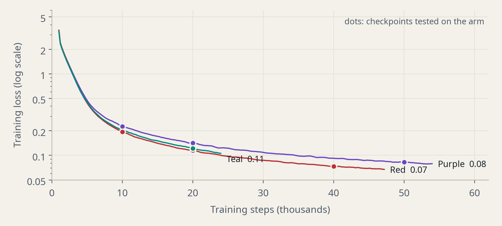
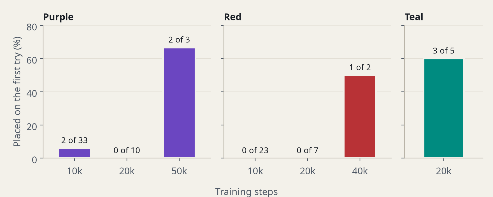

**With training, the gripper learns where to close.** Where the ring sat in the gripper camera at the moment the gripper closed, against where it sat in the demonstrations: purple 75 → 62 → 18 px, red 101 → 116 → 30 px, teal 10 px. Every placed pick closed within 20 px.

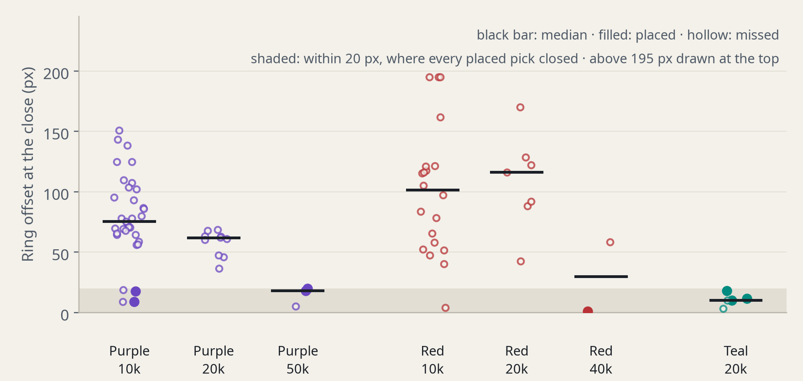

**More training, less sensitive to camera drift.** Red at 10,000 and 20,000 steps missed every run even with the stand camera only 5–6 px from where red was recorded; red at 40,000 placed with the camera 11 px off and turned 5.6°. That's one success, so it suggests rather than proves it; our guess is that the better-trained model relies more on how gripper and ring line up in the gripper camera.

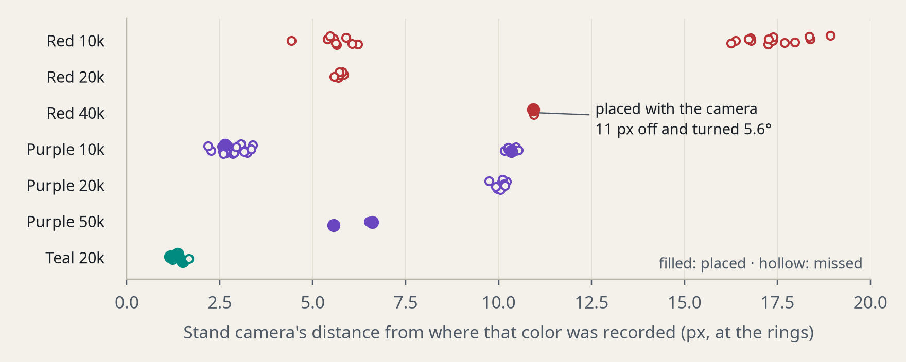

### The biggest lesson: consistent data beat more training

Measured from the first frame of every demonstration and from our robot runs:

| | Teal | Purple | Red |
|---|---|---|---|
| Camera across the takes | Steady: within 2.8 px, 0.4° | Moved: up to 23 px, 5.7° (three positions) | Steady (5 px), then moved after recording |
| Where the ring started (half of the takes within) | 15 px | 49 px | 54 px |
| ACT model on the arm | Placed at 20,000 steps | 2 of 33 at 10,000; placed at 50,000 | 0 of 23 at 10,000; placed at 40,000 |

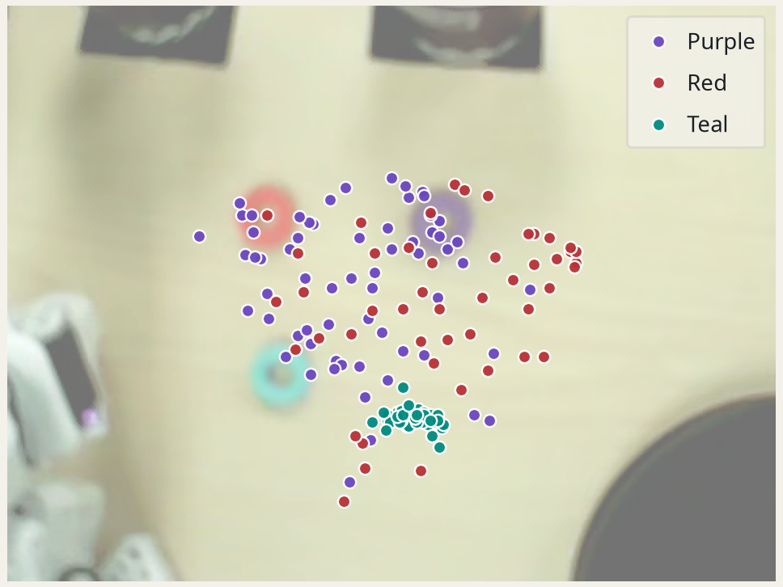

Teal had the steadiest camera and the most consistent placement, and its model worked with the least training. Teal was also recorded last, when we were most practiced, so this is the consistency of the whole recording session rather than any one variable. For a new part type: lock the camera before the first take, put the part on the same mark every time, and check both with the parts view.

### Recorded picks: improvement with training

Picks the cell made on its own, recorded by its own cameras, with the stand camera and the gripper camera side by side under the gripper check's verdict. For purple and red they show the same task at increasing training steps: the early checkpoints close beside the ring, the later ones place it. Teal worked at its first tested checkpoint, though it still misses sometimes with the ring on its mark; the gripper check catches those. Every miss shown had the ring inside its taught area and the camera where that color was recorded, so these are fair misses, not bad setups.

| Clip | Part | Model | Verdict | When |
|---|---|---|---|---|
| [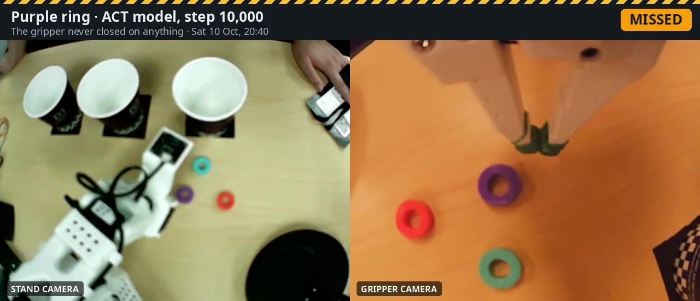](media/picks/purple_010000_20261010_204031.mp4) | Purple ring | ACT, step 10,000 | Missed: closed in front of the ring | Day 1, 20:40 |
| [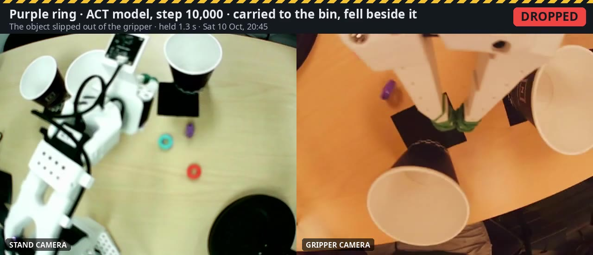](media/picks/purple_010000_20261010_204539.mp4) | Purple ring | ACT, step 10,000 | Dropped: carried to the bin, fell beside it | Day 1, 20:45 |
| [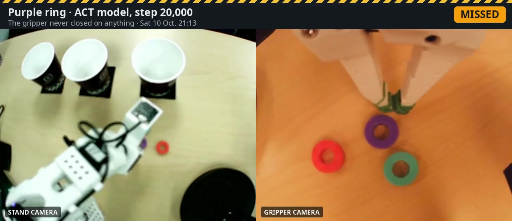](media/picks/purple_020000_20261010_211336.mp4) | Purple ring | ACT, step 20,000 | Missed: closed just short of the ring | Day 1, 21:13 |
| [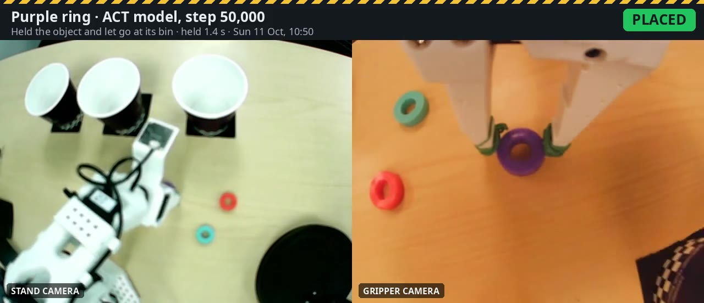](media/picks/purple_050000_20261011_105023.mp4) | Purple ring | ACT, step 50,000 | **Placed**, held 1.4 s | Day 2, 10:50 |
| [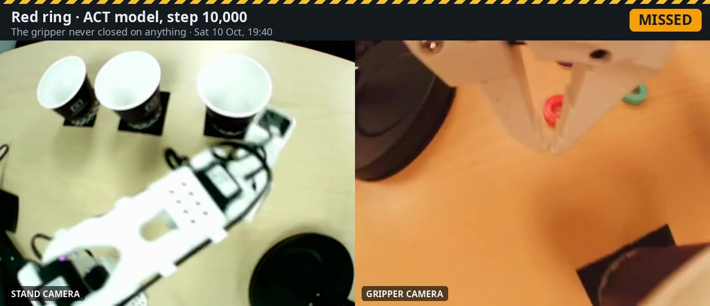](media/picks/red_010000_20261010_194038.mp4) | Red ring | ACT, step 10,000 | Missed: closed beside the ring | Day 1, 19:40 |
| [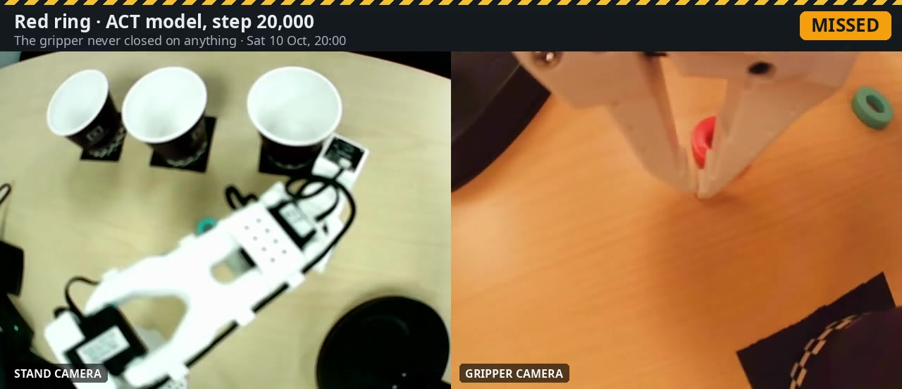](media/picks/red_020000_20261010_200003.mp4) | Red ring | ACT, step 20,000 | Missed: closed on the ring's edge | Day 1, 20:00 |
| [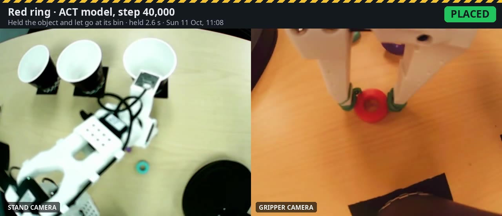](media/picks/red_040000_20261011_110803.mp4) | Red ring | ACT, step 40,000 | **Placed**, held 2.6 s | Day 2, 11:08 |
| [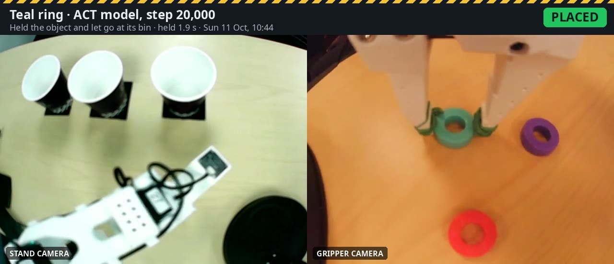](media/picks/teal_020000_20261011_104458.mp4) | Teal ring | ACT, step 20,000 | **Placed**, held 1.9 s | Day 2, 10:45 |
| [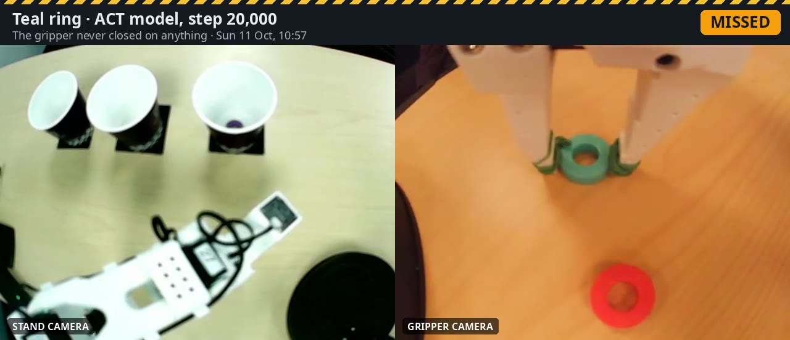](media/picks/teal_020000_20261011_105718.mp4) | Teal ring | ACT, step 20,000 | Missed: closed beside the ring, ring on its mark | Day 2, 10:57 |

The three placed picks are the project's demos, one per color (marked DEMO on the dashboard). [`examples/full_run_20261011_1108.mp4`](examples/full_run_20261011_1108.mp4) is one whole work order of all three colors, one attempt each, misses included: red and purple placed, teal missed and the gripper check caught it. The clips show what happened, not how often: see Results for the rates. The dropped purple pick is a failure the cell caught: the gripper check called it DROPPED because the gap vanished while the gripper was still told to hold, and the stand camera independently finds the ring on the table beside the bin.

### Grasp check accuracy

| Test | Result |
|---|---|
| 20 public SO-101 demonstrations from two earlier teams | 19 of 20 read as placed. The miss was a demonstration with a light squeeze. |
| Empty grasps, simulated by editing those recordings | 20 of 20 read as missed |
| Slips part-way through the carry, simulated the same way | 75 of 76 read as not placed |
| Our day-2 robot runs, checked frame by frame against both cameras | 5 of 5 verdicts matched (4 placed, 1 missed) |

### Also in the repo: camera-guided replay

An experiment, not part of the demo. The stand camera finds the ring, and the cell replays the demonstration of that color whose ring started closest, with the base turned to make up the sideways difference (0.18° per pixel, fitted to 153 grasps). It's recorded like a model run, so the same checks apply. With the ring on its mark it placed 3 of 3 first tries on day 2, but it is open loop and only works near where we demonstrated. Run it with `--label replay` (`kitcheck/replay.py`).

## Ease of use

- **A station dashboard** (`scripts/dashboard.sh`) shows the line as a factory screen:
  - incoming parts, the cell, one bin per part type and the hand-off to packing
  - a tower light (green sorting, amber retrying, red operator needed)
  - work-order buttons, and operator buttons when the cell asks
  - shift numbers: first-pass yield, operator calls, average pick time
  - an event log, a playback of every pick from the cell's own recording, and the recorded picks
- **The parts view** draws on the stand camera what the cell sees: each part with *ready*, *near edge* or *outside taught area*, its taught area, and the bins.
- **The cameras stream only while the arm is idle.** Streaming during a pick slowed the model, so the dashboard hands the cameras to the robot for each pick and shows the recording afterwards.
- **The same runs work from the terminal:** `python -m kitcheck.runner teal --label 020000`.
- **Adding a part type takes no programming:**
  1. Record about 50 demonstrations: `scripts/record.sh <part> 50`.
  2. Train: `scripts/train.sh <part>`.
  3. Learn its grasp reference: `python -m kitcheck.grasp learn ~/kitcheck_data/pick_<part> --out data/grasp_<part>.json`.
  4. Add one entry to `config.json` (label, color range, task text), then `python -m kitcheck.vision learn`.

## Setup

RingSort runs on the PC that drives the arm. It was built on Ubuntu 24.04 with an AMD Ryzen AI MAX+ 395 (Radeon 8060S, ROCm 7).

1. **LeRobot 0.6.2**, the Seeed Studio fork at commit `4aaff99b` (https://github.com/Seeed-Projects/lerobot), with the SO-101 extras, in a Python 3.12 environment with a ROCm build of PyTorch 2.7–2.11. On the cloud GPU, `scripts/cloud_setup.sh` installs the same LeRobot for training. On Linux, your user must be in the `render` group for the GPU.
2. **ffmpeg** (for the recorded-pick clips): `sudo apt install ffmpeg`.
3. **Your arm, cameras and account:** edit `scripts/settings.env`. It holds the arms' and cameras' `/dev/.../by-id/` paths, the calibration IDs and the Hugging Face user. Calibrate the arms with `lerobot-calibrate` under the same IDs.
4. **The models:** `scripts/get_model.sh <color> <step>`.
5. **The demonstrations**, only to retrain or rebuild the references below: `scripts/get_datasets.sh` downloads them into `~/kitcheck_data/`.

What's already in the repo: the grasp references, the taught areas (`data/vision.json`), the replay index (`data/replay.json`) and the camera reference frames, all learned from the demonstrations. Rebuild them after recording new takes:

```bash
python -m kitcheck.grasp learn ~/kitcheck_data/pick_teal --out data/grasp_teal.json
python -m kitcheck.vision learn
python -m kitcheck.replay learn
```

**Without an arm:** `KITCHECK_FAKE_RUN=examples/runs/purple_placed scripts/dashboard.sh` runs the whole station with every pick copied from a recorded run (see [`examples/`](examples/README.md)). `python -m pytest tests -q` runs the tests.

## Running it

On the PC, from the repository folder:

```bash
source scripts/settings.env
python -m kitcheck.camalign --once --ref teal:20         # is the stand camera where teal was recorded?
scripts/get_model.sh teal 020000                         # fetch a checkpoint
scripts/try_model.sh teal 020000                         # one scored pick
scripts/dashboard.sh                                     # the station screen: http://127.0.0.1:8078
python -m kitcheck.runner --summary                      # success rate from the log
```

On the cloud GPU: `scripts/cloud_setup.sh` once, then `scripts/train.sh <part>`. [`scripts/README.md`](scripts/README.md) lists every script.

## Repository

```
config.json          part types, color ranges, bins, work orders, retry limit
kitcheck/
  dashboard.py/.html the station screen: line view, work orders, operator calls, cameras, recorded picks
  runner.py          the sorting loop: run, check, flag the operator, log
  skill.py           runs one part's model on the arm (lerobot-rollout)
  grasp.py           the grasp check
  vision.py          the parts view: parts by color, taught areas, bins, camera position
  clips.py           recorded picks and whole-order videos, captioned, in media/ and examples/
  camalign.py        checks the stand camera against a recorded take
  align.py           browser tool for re-aligning the stand camera
  record.py          recording with manual start and stop
  replay.py          camera-guided replay (experimental)
  rollout.py         optional fixed correction to model commands (tested, not used)
  voice.py           optional spoken status with ElevenLabs (off)
scripts/             settings, recording, upload, training, model and dataset download, try-out
data/                learned references (grasp, taught areas, replay index, camera frames); run recordings stay local
media/               recorded picks (clips, posters) and media/clips.json
examples/            a whole work order on video, and two recorded picks for trying the station without an arm
tests/               tests for the grasp check, parts view, clips, replay and voice
docs/                the day-1 lab log, the pitch, and the planning history
```

## Limits

- Each part type starts from a fixed pick area. There is no feeder, so the operator restocks.
- The grasp check can't see whether a part stayed in its bin after release. The stand camera can see into the purple bin; it sees the teal bin from the side, so for teal and red it confirms the part left the table instead.
- The parts view uses fixed color ranges, measured under the event hall's lighting. Very different light would need them re-measured.
- The model is loaded fresh for every pick, which adds about 10 s of start-up.
- Model reliability is the weak point (see Results). The checks are what keep a run honest about it.

## What was prepared before the event

Before the event we worked out the idea, the plan and the design notes, with the help of chatbots. They're kept as a record in [docs/history](docs/history/README.md).

At the event we built everything else: the workcell, every demonstration, every training run and model, the station dashboard, the camera checks, the clip tools, and all testing on the arm. The training pipeline was regenerated here for LeRobot 0.6.2 and AMD Cloud. The grasp check started from a design drafted the night before and was reworked here. Five small helper scripts (`get_model.sh`, `push_checkpoint.sh`, `resume.sh`, `retrain.sh`, `overnight.sh`) are still the night-before drafts. The code was written with AI coding assistance.

## What's next

- Build the packing station downstream that pulls kits from the bins.
- Add a feeder so parts arrive without restocking by hand.
- Keep the models loaded between picks to remove the start-up delay.
- Use one language-conditioned model (e.g. SmolVLA) for all part types instead of one ACT model each.

## License

[MIT](LICENSE).
